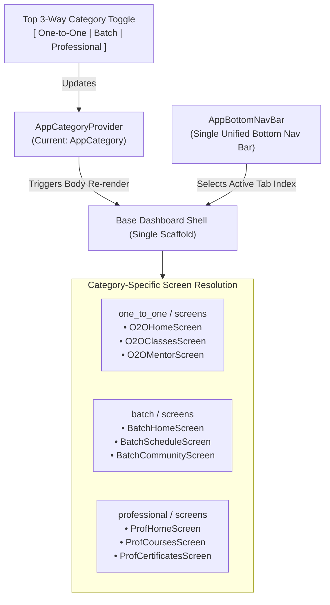

# 🎓 Multi-Category Architecture & Design Standard

This skill establishes the architectural and design standard for the three core categories in the My Mentor AI LMS app:
1. **One-to-One (`one_to_one`)**: Private mentor-led focused studies, personalized 1:1 sessions, student/parent onboarding, dedicated mentor communications.
2. **Batch (`batch`)**: Group-based cohort learning, shared schedules, collaborative peer activities, shared curriculum milestones.
3. **Professional (`professional`)**: Career acceleration, professional upskilling, self-paced courses, industry certifications, professional student profiling.

---

## 🏛️ Core Principles

### 1. Category Feature Autonomy (Zero Cross-Pollution)
Each category is an independent feature module residing in its dedicated root folder under `lib/features/`:
- `lib/features/one_to_one/`
- `lib/features/batch/`
- `lib/features/professional/`

**Rules:**
- **Zero Horizontal Coupling**: A category module must **never** import files from another category module (e.g., `batch/` must never import from `one_to_one/` or `professional/`).
- **Feature-Specific Workflows**: Screens and sub-flows are custom-tailored to the category. For example:
  - `one_to_one` includes `StudentInfoFormScreen` (grade, academic level) and `ParentInfoFormScreen` (guardian contact, communications).
  - `professional` includes `ProfessionalStudentInfoScreen` (experience, career objectives, current job/domain).
  - `batch` includes batch scheduling, cohort group selection, and peer slots.
- **Dedicated Presentation, Domain & Data**: Each category maintains its own sub-features, providers, entities, and screens.

---

### 2. Unified Base Navigation Shell with Dynamic Category Resolution
While each category has distinct screens and features, the base navigation uses a **Single Unified Bottom Navigation Shell** with a **Top Category Switcher**:



**Why this is mandatory:**
- **Zero Bottom Bar Flickering**: Toggling between categories does not push a new route or recreate the bottom bar.
- **Scroll & State Preservation**: Screen state can be preserved cleanly using `IndexedStack` or `PageStorageKey`.
- **DRY Navigation**: The bottom bar's styling, notch, active indicators, and badges are written and tested once.

---

### 3. Category-Specific Design & Visual Theming

Each category expresses its unique learning modality through distinct UI treatments while adhering to core tokens:

| Category | Primary Visual Flavor | Card & Badge Accents | Characteristic Elements |
| :--- | :--- | :--- | :--- |
| **`one_to_one`** | Personal, Focused, Mentor-Guided | `AppColors.lightBlueCard`, `AppColors.lightPurpleCard`, rounded scoops | Verified corner scoop clippers, 1:1 mentor tags, parent communication chips |
| **`batch`** | Collaborative, Community, Cohort | `AppColors.lightPurpleCard`, group tints | Peer avatars, batch timing badges, cohort progress trackers |
| **`professional`**| Sleek, Career-Oriented, Practical | `AppColors.lightPinkCard`, executive tones | Skill tags, job role badges, course certification badges, resume links |

**Design System Invariants:**
- Shared design tokens reside strictly in `lib/core/theme/` and `lib/core/constants/`.
- Generic UI primitives reside in `lib/core/widgets/` (`AppButton`, `AppTextField`, `AppImageView`, `AppContainer`, `AppDropdown`).
- Category-specific widgets reside strictly in `lib/features/<category>/presentation/widgets/`.

---

### 4. Mirrored Test Hierarchy

Every category in `lib/features/` must have a 1:1 mirrored test directory in `test/features/`:
- `test/features/one_to_one/`
- `test/features/batch/`
- `test/features/professional/`

**Requirements:**
- Every category screen must have a widget test validating its layout and category-specific inputs.
- Every category provider must have unit tests validating state updates, selections, and form submissions.
- `dart analyze lib test` must pass with **0 errors, 0 warnings, 0 infos**.
- `flutter test` must maintain a **100% pass rate**.

---

## 🛠️ Implementation Patterns

### Pattern 1: Category Enumeration & State Provider

```dart
/// The 3 supported learning categories in My Mentor.
enum AppCategory {
  oneToOne,
  batch,
  professional;

  String get label {
    switch (this) {
      case AppCategory.oneToOne:
        return "1-on-1";
      case AppCategory.batch:
        return "Batch";
      case AppCategory.professional:
        return "Professional";
    }
  }
}

class AppCategoryProvider extends ChangeNotifier {
  AppCategory _selectedCategory = AppCategory.oneToOne;

  AppCategory get selectedCategory => _selectedCategory;

  void selectCategory(AppCategory category) {
    if (_selectedCategory == category) return;
    _selectedCategory = category;
    notifyListeners();
  }
}
```

### Pattern 2: Category Screen Tab Resolver

```dart
class BaseDashboardScreen extends StatelessWidget {
  const BaseDashboardScreen({super.key});

  Widget _resolveBody(AppCategory category, int tabIndex) {
    switch (category) {
      case AppCategory.oneToOne:
        return [
          const OneToOneHomeScreen(),
          const OneToOneClassesScreen(),
          const OneToOneMentorScreen(),
          const ProfileScreen(),
        ][tabIndex];

      case AppCategory.batch:
        return [
          const BatchHomeScreen(),
          const BatchScheduleScreen(),
          const BatchCommunityScreen(),
          const ProfileScreen(),
        ][tabIndex];

      case AppCategory.professional:
        return [
          const ProfessionalHomeScreen(),
          const ProfessionalCoursesScreen(),
          const ProfessionalCertificatesScreen(),
          const ProfileScreen(),
        ][tabIndex];
    }
  }

  @override
  Widget build(BuildContext context) {
    final category = context.select<AppCategoryProvider, AppCategory>(
      (p) => p.selectedCategory,
    );
    final tabIndex = context.select<DashboardTabProvider, int>(
      (p) => p.currentIndex,
    );

    return Scaffold(
      appBar: const DashboardCategoryToggleAppBar(),
      body: _resolveBody(category, tabIndex),
      bottomNavigationBar: const AppBottomNavBar(),
    );
  }
}
```

---

## ⚡ Developer Checklist for New Features

When building or updating features in any of the three categories:

1. [ ] **Folder Placement**: Is the code placed in the correct category folder (`one_to_one`, `batch`, or `professional`)?
2. [ ] **No Cross-Imports**: Does the file avoid importing from the other two category folders?
3. [ ] **Category-Specific Design**: Does the UI reflect the specific needs of that category (e.g. professional info vs 1:1 parent info)?
4. [ ] **Clean Layering**: Are presentation, domain, and data layers cleanly isolated?
5. [ ] **Mirrored Tests**: Is a mirrored test created under `test/features/<category>/`?
6. [ ] **Quality Gate**: Does `dart analyze lib test` pass with 0 issues and `flutter test` with 100% pass rate?

